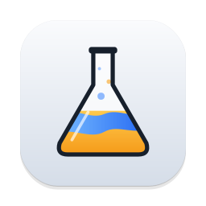

<div align="center">

  

  # Alcool

  **Windows games on your Mac, without the hassle.**

  Free and open source (GPL-3.0) · Apple Silicon · macOS 15 or later

  [](https://github.com/RodrigoLScorza/Alcool/actions/workflows/CI.yml)

  [Leia em português](README.pt-BR.md)

</div>

## What Alcool is

Alcool runs Windows games and apps on the Mac with Wine, like CrossOver does, but
free and open source. You drop an installer on it and get the game in a library,
on your Desktop and in Launchpad. Bottles, Winetricks and DLL overrides are all
still there, one level down, for when you need them.

<!-- Screenshots: images/alcool-library.png, images/alcool-install.png, images/alcool-program.png -->

## What it does differently

- **Install by dropping a file.** Drag an installer (`.exe`, `.msi`) onto the Install
  screen. Alcool says what it found in it, makes a bottle named after the game, runs
  the installer and tells you when the game reached your library.
- **The Sommelier.** Before every launch Alcool reads the game's executable, without
  running it, and sets the bottle up for what it is. WPF apps that would open as a white
  window get software rendering and the fonts they need. Electron and CEF launchers that
  draw nothing on DXMT go to DXVK. Anti-cheats that won't work under Wine are flagged
  before you waste an evening. The program page shows what it found and what it changed.
- **Installed games become Mac apps.** When an installer adds a Start Menu or Desktop
  shortcut, Alcool makes a Mac app for it in `~/Applications/Alcool` and on the
  Desktop, with the game's own icon and name.
- **A library built for playing.** The game you played last sits at the top with a
  large Play button; each card says in plain words whether the game was adjusted,
  needs D3DMetal or ships an anti-cheat.
- **Settings in plain words.** "How it runs" picks the graphics translation and the
  language per game. Wine's vocabulary stays in Advanced.

Under the hood it is Wine 11 with D3DMetal, DXMT, DXVK and WineD3D for graphics, plus
launcher fixes for Steam, Epic Games, EA App, Rockstar and Battle.net.
[ALCOOL.md](ALCOOL.md) has the technical details of everything Alcool adds.

## Status

Alcool is young. There is no signed release yet, so for now it is built from source.
Signed, notarized downloads with automatic updates come next.

## Building from source

You need Xcode 16 or later on an Apple Silicon Mac. No Apple developer account is
needed for a local build.

```sh
git clone https://github.com/RodrigoLScorza/Alcool.git
cd Alcool
xcodebuild -project Whisky.xcodeproj -scheme Whisky -configuration Debug \
  -derivedDataPath build \
  CODE_SIGN_IDENTITY="-" CODE_SIGN_STYLE=Manual DEVELOPMENT_TEAM="" \
  ENABLE_HARDENED_RUNTIME=NO SKIP_SWIFTLINT_BUILD_PHASE=YES -quiet build
cp -R build/Build/Products/Debug/Alcool.app /Applications/
open /Applications/Alcool.app
```

On first launch Alcool downloads the Wine runtime (about 330 MB).

## Alongside Whisky

Alcool has its own bundle identifier and data folders, so it can be installed next to
Whisky without sharing bottles, settings or links. Bottles from the original Whisky can
be brought over with **File → Migrate from the Original Whisky…**; they are used in
place, not copied.

## Privacy

Alcool collects no usage data. The analytics code inherited from Whisky has no project key,
so it stays off even if the setting is turned on.

## Uninstalling

Moving `Alcool.app` to the Trash leaves your bottles and the Wine runtime in place, so
a reinstall doesn't lose them. To remove everything, back up any bottle you want to keep
and then delete:

```sh
~/Library/Containers/com.rodrigoscorza.Alcool                # bottles
~/Library/Containers/com.rodrigoscorza.Alcool.Thumbnail
~/Library/Application\ Support/com.rodrigoscorza.Alcool      # Wine runtime
~/Library/Caches/com.rodrigoscorza.Alcool
~/Library/Logs/com.rodrigoscorza.Alcool
~/Library/HTTPStorages/com.rodrigoscorza.Alcool
~/Library/Preferences/com.rodrigoscorza.Alcool.plist
~/Applications/Alcool                                         # Mac apps for your games
```

Bottles created in a custom folder live wherever you put them.

## Credits

Alcool stands on other people's work:

- **[Whisky](https://github.com/Whisky-App/Whisky)**, created by
  [Isaac Marovitz](https://github.com/IsaacMarovitz), which made running Windows games
  on the Mac simple for the first time. Alcool keeps its foundations and its license.
- **[frankea/Whisky](https://github.com/frankea/Whisky)**, the fork that kept Whisky
  going after it was archived, with Wine 11, DXMT, launcher fixes, GameDB and much more.
  Alcool started from it, and the Wine runtime still comes from it.
- [Wine](https://www.winehq.org) and [CrossOver](https://www.codeweavers.com/crossover)
  by CodeWeavers, D3DMetal by Apple, [DXMT](https://github.com/3Shain/dxmt) by 3Shain,
  [DXVK-macOS](https://github.com/Gcenx/DXVK-macOS) by Gcenx and doitsujin,
  [MoltenVK](https://github.com/KhronosGroup/MoltenVK),
  [msync](https://github.com/marzent/wine-msync) by marzent,
  [Sparkle](https://github.com/sparkle-project/Sparkle),
  [SemanticVersion](https://github.com/SwiftPackageIndex/SemanticVersion) and
  [swift-argument-parser](https://github.com/apple/swift-argument-parser).

If you want commercially supported Wine on the Mac, buy
[CrossOver](https://www.codeweavers.com/crossover): CodeWeavers funds much of Wine's
development.

## License

GPL-3.0, like Whisky. See [LICENSE](LICENSE). Alcool is not affiliated with
CodeWeavers, Apple, the Whisky project or frankea.
