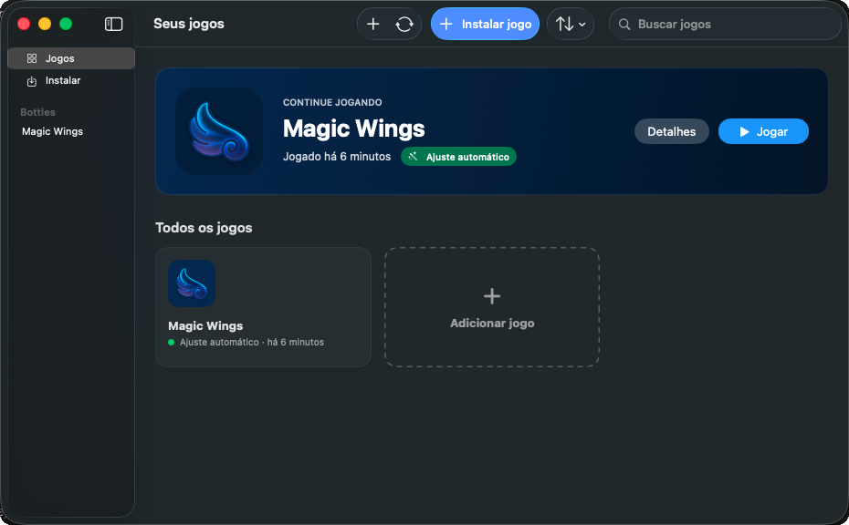
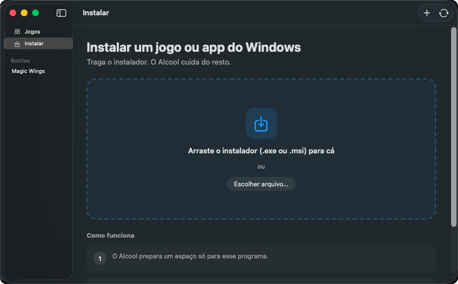
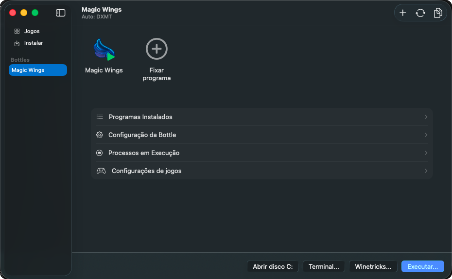

<div align="center">

  

  # Alcool

  **Jogos de Windows no seu Mac, sem complicação.**

  Livre e de código aberto (GPL-3.0) · Apple Silicon · macOS 15 ou mais recente

  [Read in English](README.md)

</div>

## O que é o Alcool

O Alcool roda jogos e programas de Windows no Mac usando o Wine, como o CrossOver,
mas é gratuito e de código aberto. Você solta um instalador nele e o jogo aparece na
biblioteca, na Mesa e no Launchpad. Bottles, Winetricks e substituições de DLL continuam
lá, um nível abaixo, para quando você precisar.

<p align="center">
  
</p>

<p align="center">
  
  
</p>

## O que ele faz de diferente

- **Instalar é soltar um arquivo.** Arraste um instalador (`.exe`, `.msi`) para a tela
  Instalar. O Alcool mostra o que encontrou nele, cria uma Bottle com o nome do jogo,
  roda o instalador e avisa quando o jogo chegou à biblioteca.
- **O Sommelier.** Antes de cada abertura, o Alcool lê o executável do jogo, sem
  rodá-lo, e prepara a Bottle para o que ele é. Apps WPF, que abririam com a janela
  branca, ganham renderização por software e as fontes de que precisam. Launchers
  Electron e CEF, que não desenham nada no DXMT, vão para o DXVK. Anti-cheats que não
  funcionam no Wine são avisados antes de você perder uma noite. A página do programa
  mostra o que ele encontrou e o que mudou.
- **Jogos instalados viram apps do Mac.** Quando um instalador cria um atalho no Menu
  Iniciar ou na Área de Trabalho, o Alcool cria um app do Mac para ele em
  `~/Applications/Alcool` e na Mesa, com o ícone e o nome do jogo.
- **Uma biblioteca feita para jogar.** O último jogo fica no topo com um botão Jogar
  grande, e cada card diz em palavras simples se o jogo foi ajustado, se precisa do
  D3DMetal ou se tem anti-cheat.
- **Ajustes em palavras simples.** "Como roda" escolhe a tradução gráfica e o idioma
  de cada jogo. O vocabulário do Wine fica em Avançado.

Por baixo, é o Wine 11 com D3DMetal, DXMT, DXVK e WineD3D para os gráficos, mais
correções para Steam, Epic Games, EA App, Rockstar e Battle.net.
O [ALCOOL.md](ALCOOL.md) traz os detalhes técnicos de tudo que o Alcool acrescenta.

## Situação

O Alcool é novo. Ainda não há versão assinada, então por enquanto ele é compilado a
partir do código. Downloads assinados e notarizados, com atualização automática, vêm
a seguir.

## Compilando

Você precisa do Xcode 16 ou mais recente num Mac com Apple Silicon. Não é preciso conta
de desenvolvedor da Apple para compilar localmente.

```sh
git clone https://github.com/RodrigoLScorza/Alcool.git
cd Alcool
xcodebuild -project Whisky.xcodeproj -scheme Whisky -configuration Debug \
  -derivedDataPath build \
  CODE_SIGN_IDENTITY="-" CODE_SIGN_STYLE=Manual DEVELOPMENT_TEAM="" \
  ENABLE_HARDENED_RUNTIME=NO SKIP_SWIFTLINT_BUILD_PHASE=YES -quiet build
cp -R build/Build/Products/Debug/Alcool.app /Applications/
open /Applications/Alcool.app
```

Na primeira abertura, o Alcool baixa o Wine (cerca de 330 MB).

## Junto com o Whisky

O Alcool tem identificador e pastas próprias, então pode ficar instalado ao lado do
Whisky sem dividir Bottles, ajustes ou links. Bottles do Whisky original podem ser
trazidas em **Arquivo → Migrate from the Original Whisky…**; elas são usadas no lugar
onde estão, sem cópia.

## Privacidade

O Alcool não coleta dados de uso. O código de estatísticas herdado do Whisky não tem
chave de projeto, então continua desligado mesmo que a opção seja ativada.

## Desinstalando

Mover o `Alcool.app` para o Lixo mantém suas Bottles e o Wine, para que uma
reinstalação não as perca. Para remover tudo, faça backup das Bottles que quiser
manter e apague:

```sh
~/Library/Containers/com.rodrigoscorza.Alcool                # Bottles
~/Library/Containers/com.rodrigoscorza.Alcool.Thumbnail
~/Library/Application\ Support/com.rodrigoscorza.Alcool      # Wine
~/Library/Caches/com.rodrigoscorza.Alcool
~/Library/Logs/com.rodrigoscorza.Alcool
~/Library/HTTPStorages/com.rodrigoscorza.Alcool
~/Library/Preferences/com.rodrigoscorza.Alcool.plist
~/Applications/Alcool                                         # apps do Mac dos seus jogos
```

Bottles criadas numa pasta personalizada ficam onde você as colocou.

## Créditos

O Alcool existe graças ao trabalho de outras pessoas:

- **[Whisky](https://github.com/Whisky-App/Whisky)**, criado por
  [Isaac Marovitz](https://github.com/IsaacMarovitz), que tornou simples rodar jogos
  de Windows no Mac pela primeira vez. O Alcool mantém a base e a licença dele.
- **[frankea/Whisky](https://github.com/frankea/Whisky)**, o fork que manteve o Whisky
  vivo depois de arquivado, com Wine 11, DXMT, correções de launchers, GameDB e muito
  mais. O Alcool começou a partir dele, e o Wine ainda vem dele.
- [Wine](https://www.winehq.org) e [CrossOver](https://www.codeweavers.com/crossover)
  da CodeWeavers, D3DMetal da Apple, [DXMT](https://github.com/3Shain/dxmt) de 3Shain,
  [DXVK-macOS](https://github.com/Gcenx/DXVK-macOS) de Gcenx e doitsujin,
  [MoltenVK](https://github.com/KhronosGroup/MoltenVK),
  [msync](https://github.com/marzent/wine-msync) de marzent,
  [Sparkle](https://github.com/sparkle-project/Sparkle),
  [SemanticVersion](https://github.com/SwiftPackageIndex/SemanticVersion) e
  [swift-argument-parser](https://github.com/apple/swift-argument-parser).

Se você quer um Wine com suporte comercial no Mac, compre o
[CrossOver](https://www.codeweavers.com/crossover): a CodeWeavers financia boa parte
do desenvolvimento do Wine.

## Licença

GPL-3.0, como o Whisky. Veja [LICENSE](LICENSE). O Alcool não é afiliado à
CodeWeavers, à Apple, ao projeto Whisky nem ao frankea.
